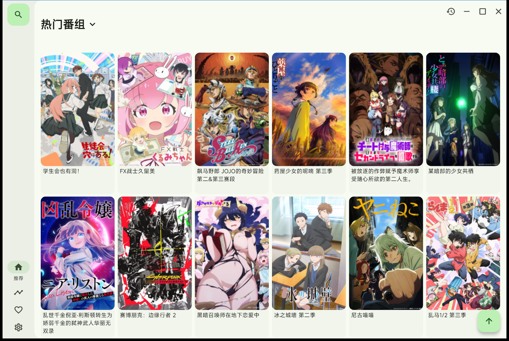
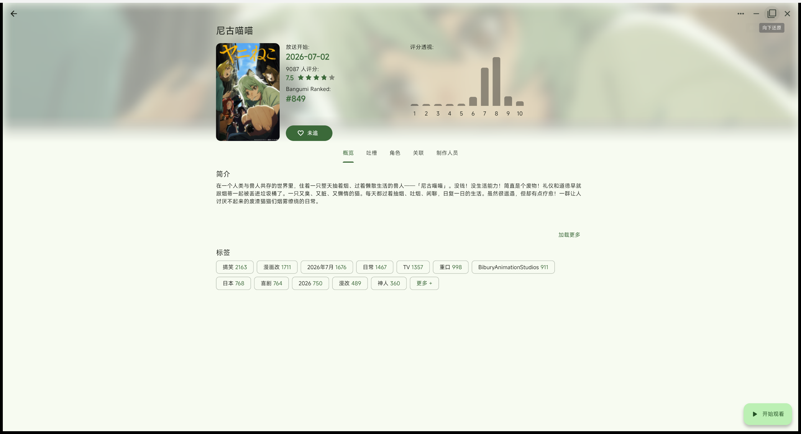
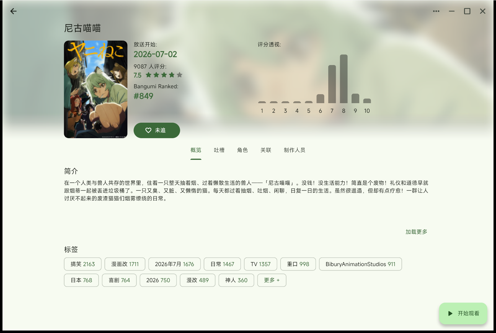

<h1 align="center">Kazumi Window Controls</h1>

<p align="center">
  Minimize / maximize / restore buttons for <a href="https://github.com/Predidit/Kazumi">Kazumi</a>'s frameless title bar —
  the same size, style and alignment as the existing close button.
</p>

<p align="center">
  <a href="https://github.com/Predidit/Kazumi"></a>
  
  
  
</p>

<p align="center">
  <a href="README.zh-CN.md"><b>简体中文完整说明</b></a> · English
</p>

> **中文读者 / Chinese readers:** this file stays in English. A complete, self-contained
> Chinese guide — quick start, all three installation methods, build steps and FAQ — is
> available in **[README.zh-CN.md](README.zh-CN.md)**
> （[中文构建指南](docs/BUILD.zh-CN.md)）.

<details>
<summary><b>中文简介（点击展开）</b></summary>

为 **Kazumi 2.3.9** 的无边框标题栏补上「最小化 / 最大化 / 还原」按钮：

- 位置在原有「关闭」按钮左侧，顺序为 `－ □ ✕`；
- 三个按钮同为 Material `IconButton`，尺寸、图标大小、颜色、垂直对齐完全一致；
- 纯 Dart 实现，不改任何 C++ / 原生代码，也没有新增依赖；
- 最大化状态实时同步（支持双击标题栏、`Win` + `↑` 等系统方式）；
- 开启「系统标题栏」时自动隐藏，不会和原生按钮重复。

安装（完整步骤见中文说明）：

```bash
git clone --branch 2.3.9 --depth 1 https://github.com/Predidit/Kazumi.git
cd Kazumi
git apply /path/to/patch/window-buttons.patch
flutter pub get
flutter build windows --release
```

更多内容：[中文完整说明](README.zh-CN.md) · [中文构建指南](docs/BUILD.zh-CN.md)

</details>



## Why

Kazumi hides the native Windows title bar (`TitleBarStyle.hidden`) and draws its own
controls. Until now that custom title bar only had a **close** button, so minimizing or
maximizing required the taskbar or a keyboard shortcut.

This project adds the two missing buttons next to the close button, without changing
any native code and without touching the window style.

## Features

- **Minimize** and **maximize / restore** buttons placed immediately left of the existing close button.
- **Pixel-identical** sizing, icon size, color and vertical alignment: all three buttons are
  plain Material `IconButton`s (Flutter's `CloseButton` is built from an `IconButton` too),
  so they inherit the same `IconButtonTheme` and `IconTheme`.
- **Live maximize state**: the icon switches between `□` and `❐` and the tooltip between
  “最大化” and “向下还原”, even when the window is maximized with `Win`+`↑` or by double-clicking.
- **Zero native changes** — pure Dart, works on Windows, Linux and macOS.
- Automatically hidden when the native title bar is enabled (`showWindowButton` setting),
  so you never get duplicate buttons.

## Screenshots

| Home | Maximized (restore state) |
| --- | --- |
|  |  |
| **Detail page** | **Restore tooltip** |
|  |  |

## How it works

The new widget is a `Row` of two ordinary `IconButton`s:

```dart
IconButton(
  tooltip: '最小化',
  onPressed: () => windowManager.minimize(),
  icon: const Icon(Icons.remove),
),
IconButton(
  tooltip: _isMaximized ? '向下还原' : '最大化',
  onPressed: _toggleMaximize,
  icon: Icon(_isMaximized ? Icons.filter_none : Icons.crop_square),
),
```

`WindowControlButtons` mixes in `windowManager`'s `WindowListener` to keep `_isMaximized`
in sync with the real window state. It is inserted in front of every desktop close button:

| File | Change |
| --- | --- |
| `lib/bean/appbar/window_control_buttons.dart` | **New** widget with both buttons |
| `lib/bean/appbar/sys_app_bar.dart` | Settings, search, downloads, profile, timeline… |
| `lib/pages/popular/popular_page.dart` | Home page (“热门番组”) |
| `lib/pages/info/info_page.dart` | Anime detail page |

## Compatibility

- Kazumi **2.3.9** (the patch is generated against tag `2.3.9`).
- Flutter **3.47.7** (the version pinned by Kazumi 2.3.9).
- Tested on **Windows 11** (frameless title bar). The code only uses `window_manager`,
  so Linux and macOS should work as well.
- When “show native window buttons” is enabled in Kazumi's settings, the custom buttons
  hide together with the custom close button and the native caption buttons are used.

## Installation

### Option 1 — apply the patch (recommended)

```bash
git clone --branch 2.3.9 --depth 1 https://github.com/Predidit/Kazumi.git
cd Kazumi
git apply /path/to/patch/window-buttons.patch
flutter pub get
flutter build windows --release
```

Or use the helper script:

```powershell
.\scripts\apply-patch.ps1
```

### Option 2 — copy the changed files

Copy the four files from [`src/`](src) into the same paths of a Kazumi 2.3.9 checkout.

### Replacing `app.so` in an existing release

If you only rebuild the Dart snapshot and replace `data/app.so`:

> **Also replace `data/flutter_assets/fonts/MaterialIcons-Regular.otf` with the font from the
> same build.** Official Kazumi releases ship an icon-tree-shaken material icon font that does
> not contain `Icons.remove`, `Icons.crop_square` or `Icons.filter_none`. Without the new font
> the two buttons occupy space but their icons are invisible.

## Build notes

Official Kazumi builds inject signing credentials at compile time:

```text
DANDANAPI_APPID, DANDANAPI_KEY, KAZUMI_APPID, KAZUMI_KEY
```

They are read with `String.fromEnvironment` and are only needed for signed danmaku / mirror
requests. The project compiles fine without them; provide your own values if you need those
features:

```bash
flutter build windows --release \
  --dart-define=DANDANAPI_APPID=... \
  --dart-define=DANDANAPI_KEY=... \
  --dart-define=KAZUMI_APPID=... \
  --dart-define=KAZUMI_KEY=...
```

See [docs/BUILD.md](docs/BUILD.md) (English) or [docs/BUILD.zh-CN.md](docs/BUILD.zh-CN.md)
（中文）for the full and the snapshot-only build flows.

## Verification

Verified on Windows 11 with Kazumi 2.3.9:

| Check | Result |
| --- | --- |
| Three buttons share the same size / color / baseline | ✅ same `IconButton` theme |
| Minimize | ✅ `IsIconic = true` |
| Maximize | ✅ window covers the work area, `IsZoomed = true` |
| Restore | ✅ original rect restored, `IsZoomed = false` |
| Icon + tooltip follow window state | ✅ `□` ↔ `❐`, “最大化” ↔ “向下还原” |
| Original close button behavior | ✅ unchanged |

## Project structure

```text
.
├── docs/
│   ├── BUILD.md
│   ├── BUILD.zh-CN.md
│   └── images/
├── patch/
│   └── window-buttons.patch
├── scripts/
│   └── apply-patch.ps1
└── src/
    └── lib/…                 # the four changed files
```

## Uninstall

Revert the patch (`git apply -R patch/window-buttons.patch`) or restore your previous
`app.so` and icon font. The rest of Kazumi is untouched.

## Documentation

| Language | Document |
| --- | --- |
| English | `README.md` (this file) |
| 简体中文 | [README.zh-CN.md](README.zh-CN.md) — complete Chinese guide |
| Build guide (English) | [docs/BUILD.md](docs/BUILD.md) |
| 构建指南（中文） | [docs/BUILD.zh-CN.md](docs/BUILD.zh-CN.md) |
| Changelog | [CHANGELOG.md](CHANGELOG.md) |

## Credits

- [Predidit/Kazumi](https://github.com/Predidit/Kazumi) — the upstream application.
- [window_manager](https://pub.dev/packages/window_manager) — window state and caption control.
- Everyone who reported the missing buttons.

## License

Kazumi is licensed under the **GNU General Public License v3.0**. This patch is a derivative
work and is distributed under the same license — see [LICENSE](LICENSE).
